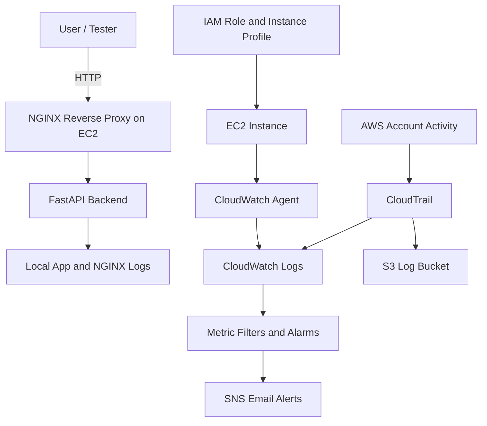

# AWS Threat Lab

A hands-on AWS security and monitoring lab built to demonstrate cloud infrastructure provisioning, hardening, centralized logging, detection engineering, and attack simulation.

## Objectives

- Build AWS infrastructure with Terraform
- Configure and harden servers with Ansible
- Collect AWS and host logs in CloudWatch
- Detect suspicious activity with CloudWatch alarms
- Simulate attacks and validate detections

## Stack

- AWS VPC
- AWS EC2
- AWS IAM
- AWS CloudTrail
- AWS CloudWatch
- AWS SNS
- AWS S3
- Terraform
- Ansible
- NGINX
- FastAPI
- fail2ban

## Architecture



## Current Features

- Terraform-managed AWS infrastructure
- Ansible-managed server hardening
- NGINX reverse proxy
- FastAPI backend application
- CloudTrail log collection
- CloudWatch metric filters and alarms
- SNS email notifications
- Host log collection for auth, syslog, and NGINX logs

## Deployment

### Terraform

```yaml
cd infra/terraform
terraform init
terraform fmt -recursive
terraform validate
terraform plan
terraform apply
```

### Ansible

```yaml
cd config/ansible
ansible-playbook playbook.yml
```

## Test the App

```yaml
curl http://<EC2_PUBLIC_IP>/
curl http://<EC2_PUBLIC_IP>/health
curl "http://<EC2_PUBLIC_IP>/login?username=admin"
```

## Project Status

Phase 1 is complete:

- AWS infrastructure deployed
- Web app running behind NGINX
- CloudTrail enabled
- Alerts configured
- Host logs collected in CloudWatch

Planned Next Steps

- host-based SSH failure detections
- CloudWatch dashboards
- attack simulation scripts
- CI/CD with GitHub Actions
- optional Wazuh integration

---

## Phase 1 — MVP (basic AWS lab)

- [x] Terraform VPC
- [x] Terraform EC2
- [x] IAM role for EC2
- [x] S3 bucket for logs
- [x] CloudTrail enabled
- [x] CloudWatch log group
- [x] SNS email alerts
- [x] Basic CloudWatch alarm
- [x] NGINX installed via Ansible
- [x] Web app deployed
- [x] Logs visible from host
- [x] Architecture diagram
- [x] README with diagram

Status: Complete

---
