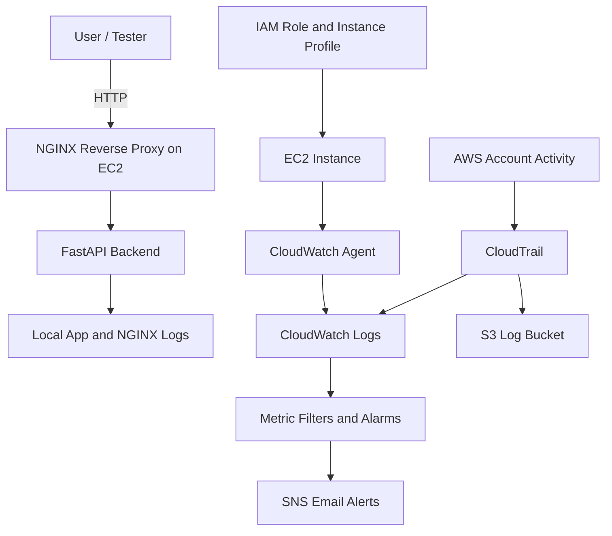

# AWS Threat Lab

A hands-on AWS security and monitoring lab built to demonstrate cloud infrastructure provisioning, hardening, centralized logging, detection engineering, and attack simulation.

## Objectives

- Build AWS infrastructure with Terraform
- Configure and harden servers with Ansible
- Collect AWS and host logs in CloudWatch
- Detect suspicious activity with CloudWatch alarms
- Simulate attacks and validate detections

## Stack

- AWS VPC
- AWS EC2
- AWS IAM
- AWS CloudTrail
- AWS CloudWatch
- AWS SNS
- AWS S3
- Terraform
- Ansible
- NGINX
- FastAPI
- fail2ban

## Architecture



## Current Features

- Terraform-managed AWS infrastructure
- Ansible-managed server hardening
- NGINX reverse proxy
- FastAPI backend application
- CloudTrail log collection
- CloudWatch metric filters and alarms
- SNS email notifications
- Host log collection for auth, syslog, and NGINX logs
- Evidence S3 bucket with versioning and lifecycle rules
- AWS Budget alerts for cost safety
- SSH hardening with key-only auth and fail2ban
- CloudTrail detections for root use, login failures, IAM changes, security group changes, and new access keys
- Host detections for SSH auth failures, sudo usage, and NGINX error spikes
- CloudWatch security dashboard

## Deployment

### Terraform

```yaml
cd infra/terraform
terraform init
terraform fmt -recursive
terraform validate
terraform plan
terraform apply
```

### Ansible

```yaml
cd config/ansible
ansible-playbook playbook.yml
```

## Test the App

```yaml
curl http://<EC2_PUBLIC_IP>/
curl http://<EC2_PUBLIC_IP>/health
curl "http://<EC2_PUBLIC_IP>/login?username=admin"
```

## Project Status

Current repo status:

- Phase 1 complete
- Phase 2 complete, with optional firewall/private subnet work still open
- Phase 3 mostly complete
- Phase 5 partially implemented

Planned Next Steps

- backend error spike detection
- more readable/customized alert messages
- attack simulation scripts
- CI/CD with GitHub Actions
- optional Wazuh integration

---

## Roadmap Snapshot

| Phase | Status |
| ----- | ------ |
| Phase 1 | DONE |
| Phase 2 | DONE |
| Phase 3 | MOSTLY COMPLETE |
| Phase 4 | NOT STARTED |
| Phase 5 | PARTIAL |
| Phase 6 | OPTIONAL |

### Phase 1 — MVP (basic AWS lab)

- [x] Terraform VPC
- [x] Terraform subnet
- [x] Terraform route table + internet gateway
- [x] Terraform EC2
- [x] SSH key pair
- [x] Security group (SSH restricted, HTTP open)
- [x] IAM role for EC2
- [x] S3 bucket for CloudTrail logs
- [x] CloudTrail enabled
- [x] CloudWatch log groups
- [x] CloudWatch agent installed on EC2
- [x] SNS email alerts
- [x] Basic CloudWatch alarm
- [x] Ansible provisioning
- [x] NGINX reverse proxy
- [x] FastAPI backend
- [x] systemd service
- [x] backend bound to localhost only
- [x] curl works
- [x] logs visible in CloudWatch
- [x] CloudTrail events visible
- [x] Architecture diagram
- [x] README
- [x] repo structure

Status: Complete

---

### Phase 2 — Security Hardening

- [x] restrict SSH to trusted IP
- [x] backend not exposed publicly
- [x] only NGINX exposed
- [x] disable root login
- [x] disable password authentication
- [x] fail2ban for SSH
- [x] automatic updates
- [x] nginx logs -> CloudWatch
- [x] syslog -> CloudWatch
- [x] auth.log -> CloudWatch
- [x] separate evidence S3 bucket
- [x] AWS Budget
- [x] budget alarm email
- [x] S3 evidence bucket
- [x] lifecycle rules
- [x] threat-model.md
- [x] hardening.md
- [ ] firewall rules (optional)
- [ ] private subnet (optional)

Status: Complete, with optional items pending

---

### Phase 3 — Detection Engineering

- [x] Console login failure
- [x] IAM policy change
- [x] Root login
- [x] Security group change
- [x] New access key
- [x] CloudWatch metric filters
- [x] CloudWatch alarms
- [x] SNS email alerts
- [x] CloudWatch dashboard
- [ ] readable alarm messages
- [x] SSH brute force detection
- [x] sudo abuse detection
- [x] nginx error spike
- [ ] backend error spike
- [x] detections.md
- [x] alerts.md

Status: Mostly Complete
