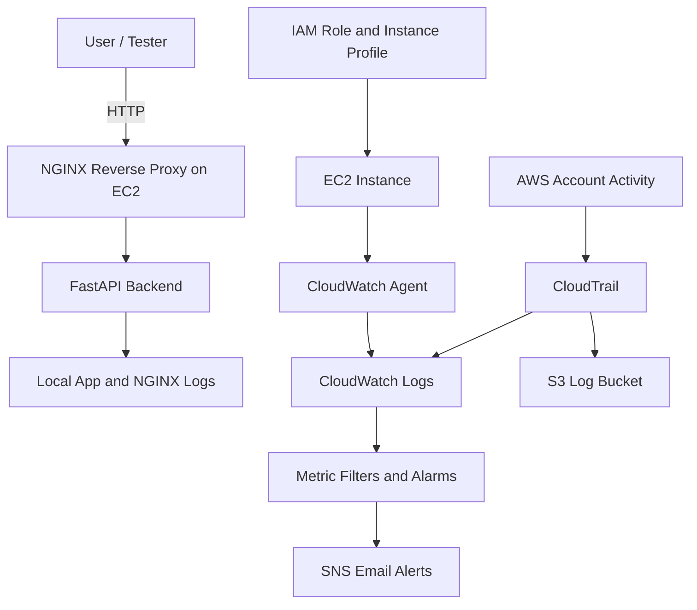

# Architecture

## Overview

The AWS Threat Lab is a small production-style cloud environment designed to demonstrate infrastructure provisioning, hardening, centralized logging, detection engineering, and attack simulation.

## Components

- VPC with a public subnet
- EC2 instance running:
  - NGINX reverse proxy
  - FastAPI backend
  - CloudWatch Agent
  - fail2ban
- IAM role attached to EC2
- CloudTrail for AWS API activity
- CloudWatch Logs for AWS and host logs
- SNS for email alerting
- S3 bucket for CloudTrail log storage

## Mermaid Diagram

---
